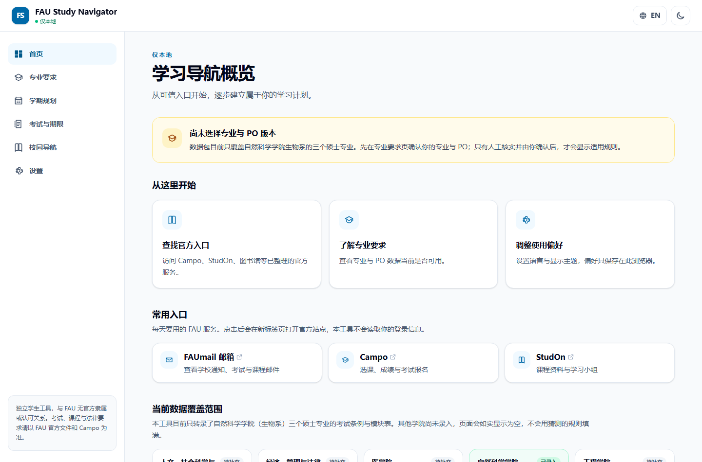
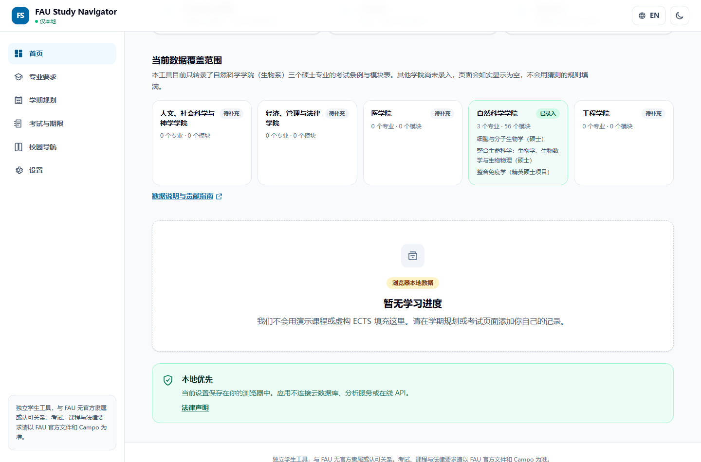
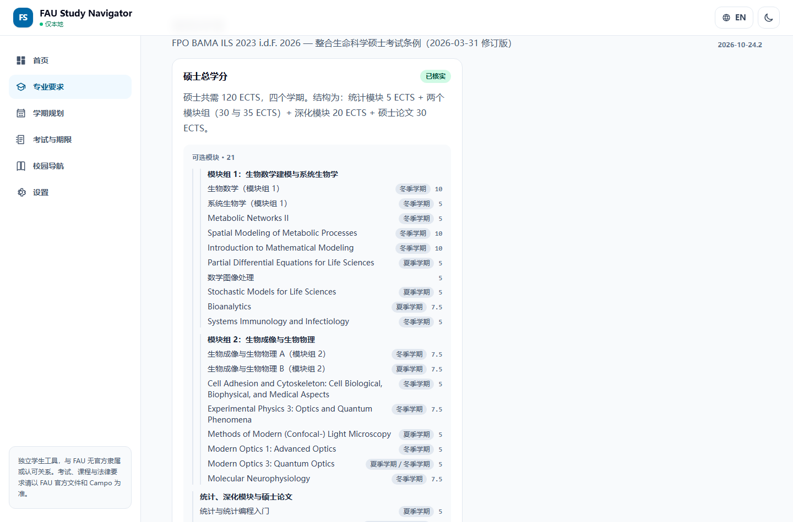
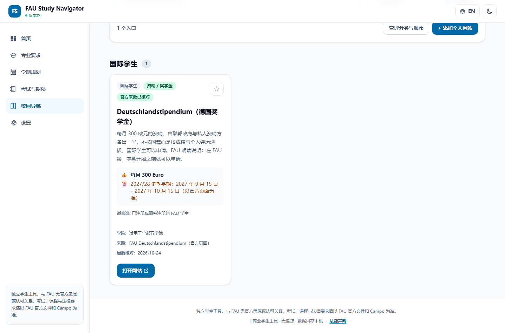
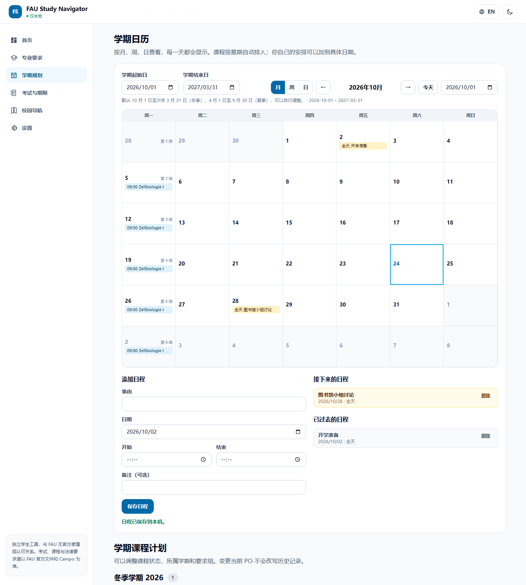
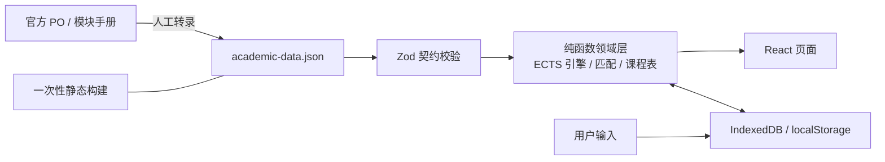

# FAU Study Navigator

[](https://github.com/tommy2345-art/FAU-Studyinfo-Navigator/actions/workflows/ci.yml)
[](LICENSE)

面向 FAU（Friedrich-Alexander-Universität Erlangen-Nürnberg）学生的**本地优先**学习导航与个人规划工具。无后端、无账号、无遥测，所有个人数据只存在你自己的浏览器里。

**在线使用：** https://fau-studyinfo-navigator.pages.dev

> 独立学生工具，与 FAU 没有官方隶属或认可关系。考试报名、课程注册、成绩、学分认定以及具有法律效力的要求，一律以 FAU 官方文件和 Campo 为准。

---

## 这是什么

- **给谁用**：在 FAU 读书、需要把「专业要求 + 选课 + 考试 + 资源入口」放在一个地方的学生。
- **解决什么**：官方信息散在 Campo、StudOn、学院页面和一堆 PDF 里；这个工具把已核实的规则、模块、ECTS 和常用入口整理成可查询、可规划的本地应用。
- **不做什么**：不登录 FAU、不读取 Campo/StudOn、不报名考试、不收集个人数据、不猜学术规则。
- **数据从哪来**：维护者对照官方考试条例与模块手册**人工转录**，每条规则都带来源和核对日期。

## 界面一览

| 首页：常用入口 + 覆盖范围 | 覆盖范围：哪些学院已录入 |
| --- | --- |
|  |  |
| **专业要求：模块、ECTS、开课学期** | **校园导航：国际学生资助与截止窗口** |
|  |  |

**学期日历：月 / 周 / 日三种视图，学期起止日可编辑，个人安排分「接下来」与「已过去」。**



## 功能总览

| 功能 | 能做什么 |
| --- | --- |
| 专业要求 | 按「学位 + 学院 + 专业 + 入学学期 + PO」解析；树形规则；模块 ECTS 与开课学期；官方来源可点开核对 |
| 学期规划 | 课程目录选择器（带模块代码、ECTS、可计入组）、手动加课、重修记录、ECTS 进度与风险提示 |
| 课程表 | 08:00–21:00 周网格；一门课可跨星期；冲突高亮；按开始时间定位 |
| 学期日历 | 月 / 周 / 日三种视图；起止日可编辑（默认 10-01 至 03-31 或 04-01 至 09-30）；课程按星期重复且只在学期区间内；个人日程分「接下来」与「已过去」 |
| 数据不丢 | 逐条写入 IndexedDB + BroadcastChannel 跨标签页同步；自动保存时间可见；可请求浏览器持久化；备份包含课程/考试/任务/日程 |
| 考试与任务 | 个人考试、报名状态、地点、备注、任务、时间线、本地生成 ICS |
| 校园导航 | 30 条资源、7 个分类、收藏、自定义网站、按截止日排序、国际学生专区 |
| 数据治理 | 版本化 JSON 备份 / 恢复、冲突校验、一键清空本地数据 |
| 隐私与安全 | 无后端、无 Cookie、无分析、无后台请求；严格 CSP；全部数据只在本机 |

## 项目怎么设计

一句话：**静态数据包 + 纯函数领域层 + 只写本机的个人数据**。



界面不自己判断学分或 PO，规则放在 `src/domain/` 的纯函数里；数据由 Zod 在构建时校验，坏数据进不了包。

完整架构、数据模型和设计取舍见 **[docs/DESIGN.md](docs/DESIGN.md)**。

## 覆盖范围

**本项目主要聚焦自然科学学院（生物系）的三个硕士专业。** 这不是「还没做完」，而是当前版本的明确范围：每一条学业规则都必须对照官方考试条例逐条转录、并经过人工核实，没有捷径。

| 专业 | 学位 | 当前 PO | 已录入模块 | 状态 |
|---|---|---|---|---|
| 细胞与分子生物学 Cell and Molecular Biology | M.Sc. | FPO BAMA Bio 2026（2019 版亦已转录） | 13 | 已核实 |
| 整合生命科学 Integrated Life Sciences | M.Sc. | FPO BAMA ILS 2026 | 32 | 已核实，逐模块对照 SoSe 2026 模块手册 |
| 整合免疫学 Integrated Immunology | M.Sc. | FPO iImmune 2026（2022 版仅登记） | 11 | 已核实 |

数据包里共 **56 个模块、69 个模块版本、20 个要求组、5 个 PO 版本、17 条官方来源**。

### 其他学院？还没有，位置留给你

人文、经济、医学、工程四个学院，以及自然科学学院的其余专业，**目前完全没有培养计划与 PO 数据**。应用不会编造它们，而是明确显示「该学院尚未录入」并给出贡献入口。

这是有意设计的扩展点：

- 数据集中在 [`src/data/academic/academic-data.json`](src/data/academic/academic-data.json)，不需要改 React 组件；
- 首页的「当前数据覆盖范围」直接从数据推导，录入后自动从「待补充」变成「已录入」；
- 具体步骤见 **[docs/ADDING_A_FACULTY.md](docs/ADDING_A_FACULTY.md)**，一次录一个专业就够；
- 也可以只提交资料：[「我的学院缺失」issue 模板](.github/ISSUE_TEMPLATE/faculty-data.yml)。

---

## What this is (English)

A local-first study planner and resource navigator for FAU students. It has no
backend, no accounts and no analytics; every personal record stays in the
browser's IndexedDB or localStorage.

**Coverage is deliberately narrow:** the data package transcribes the
examination regulations and module tables of three master programmes in the
Faculty of Sciences, Department of Biology (Cell and Molecular Biology,
Integrated Life Sciences, Integrated Immunology). Every other faculty is empty
and shows an explicit "not entered yet" notice instead of guessed rules.

The extension point is the data file, not the UI: see
[docs/ADDING_A_FACULTY.md](docs/ADDING_A_FACULTY.md) and
[CONTRIBUTING.md](CONTRIBUTING.md).

---

## 功能

- 六个主页面：概览、专业要求、学期规划、考试与期限、校园导航、设置；另有 404 与法律声明页。
- 专业要求按 `学位类型 + 学院 + 专业 + 入学学期 + PO 版本` 解析；系统不会替你选中「最新 PO」。
- 规则按树形渲染：父组显示 ECTS 与子组，子组列出模块、ECTS 与开课学期；每张卡片附官方来源。
- 验证状态可见：已核实 / 暂定 / 待复核 / 未核实 / 来源冲突。
- 学期规划：课程目录选择器（带模块代码、ECTS、开课学期、可计入的要求组）、手动录入额外课程、重修记录。
- 08:00–21:00 周课程表：一门课可跨多个星期、每个星期独立时间、冲突高亮、剩余时间提示。
- ECTS 引擎（纯函数，有测试）：区分 planned / enrolled / passed / failed / recognized；规则不完整时结论保持 `unknown`。
- 考试与学习任务、`Europe/Berlin` 墙钟校验（含夏令时边界）、本地生成 ICS。
- 30 条资源、7 个分类（含 17 条国际学生资助与支持入口）、机会徽章、按截止日排序、收藏与自定义网站。
- 版本化 JSON 备份导出与恢复，带大小、结构、冲突校验；设置页可二次确认清空本地数据。
- 严格 CSP、无 CDN/远程字体/远程脚本、禁止后台远程请求（有静态扫描测试保护）。
- 简体中文默认，英文完全对等（键集不一致会导致测试失败）。

## 技术栈

React 19 · Vite 8 · TypeScript strict · Tailwind CSS 4 · React Router 7 · Zod · Zustand · IndexedDB · Vitest · Playwright

领域规则放在 `src/domain/` 的纯函数里，React 组件不承担学分或 PO 判断。

## 本地开发

要求 Node.js `>= 22.13.0`、npm 10+。

```bash
npm ci
npm run dev      # http://127.0.0.1:5173
```

始终使用 `127.0.0.1`，不要和 `localhost` 交替访问：浏览器视为不同站点，你会看到不同的本地数据。

### 质量门禁

```bash
npm run lint
npm run typecheck
npm run test        # 静态检查 34 项 + 单元测试
npm run test:data   # 学术数据引用完整性、PO 范围、ECTS 算术
npm run test:e2e    # 需要先执行 npx playwright install chromium
npm run build
```

E2E 会自己构建并用 `npm run preview` 起服务，测试的是真实生产包。

## 部署

纯静态前端，构建产物在 `dist/`。生产环境使用 Cloudflare Pages（`wrangler.jsonc` 中 `not_found_handling: "single-page-application"`）。

```bash
npm run build
npx wrangler pages deploy dist --project-name fau-studyinfo-navigator
```

**不要给 Cloudflare 生成 `dist/404.html`。** Cloudflare Pages 会把它当作权威的 404 响应体，导致 `/degree` 等深链接返回 404 状态码。这个坑已经踩过并写进 `scripts/postbuild.mjs` 的注释。

### GitHub Pages 镜像

`main` 每次推送会顺带部署一份 GitHub Pages 镜像：
https://tommy2345-art.github.io/FAU-Studyinfo-Navigator/

GitHub Pages 没有服务端 SPA 回退，只能靠根目录的 `404.html`，因此该镜像的深链接（如 `/degree`）**返回 404 状态码但页面能正常渲染**。这是平台限制，Cloudflare 上不存在这个问题。需要干净的 200 状态码和搜索引擎收录时用主站。

## 数据来源与真实性

- 每条规则绑定至少一个 `AcademicSource`，来源必须是 HTTPS 官方地址。
- 无法确认的数值保持 `null`：例如整合免疫学的「项目工作研讨课」ECTS 至今未确认，界面会显示「ECTS 待确认」而不是猜一个数字。
- 2019 版 ZMB 条例只登记来源、未转录模块表；选中它的老生会看到「此版本尚未逐条录入……你的选择仍然有效」，而不是「没有规则」。
- ILS 的 32 个模块逐条对照 SoSe 2026 模块手册，手册 SHA-256、页码和 35 条断言都在测试里，数据与 PDF 漂移会直接让构建失败。
- 「schema 通过」不等于「内容真实」；只有人工复核后才能标 `verified`。

官方 PDF 与手册存放在 `sources/`，用于核对，版权归 FAU，不在 MIT 许可范围内。

## 数据存储位置

| 数据 | 位置 |
|---|---|
| 语言、主题 | `localStorage: fau-study-navigator.preferences.v1` |
| 资源范围、排序、收藏、自定义分类与网站 | `localStorage: fau-study-navigator.resources.v1` |
| 专业范围与已确认 PO | IndexedDB `academic-profile` |
| 课程、学期时间与重修记录 | IndexedDB `planner-courses` / `planner-attempts` |
| 个人考试与学习任务 | IndexedDB `personal-exams` / `study-tasks` |
| 个人日程（日历） | IndexedDB `calendar-events` |
| 学期起始日 | `localStorage: fau-study-navigator.calendar.v1` |
| 学院、来源与学业规则 | 随构建发布的只读数据包 |

所有个人数据都在当前浏览器。换设备看不到，清站点数据会丢；迁移用设置页的 JSON 备份。

**如何降低「数据突然没了」的风险：**

- 每次写入后，学期规划页会显示「最近自动保存」时间；保存失败会明确提示，不会假装成功。
- **逐条写入**：新增/修改课程与日程只写对应记录，不再整包重写；两个标签页同时编辑不会互相删除。
- **跨标签页同步**：写入后通过 `BroadcastChannel` 通知其他标签页重新读取，不需要手动刷新。
- 设置页 →「持久化与自动保存」可以请求浏览器授予**持久化存储**（`navigator.storage.persist()`），降低空间不足时被清理的概率，并显示已用空间。
- 备份导出已包含专业选择、课程、考试、任务与个人日程；恢复按 ID 合并并拒绝冲突。
- 清除浏览器站点数据仍然会删除一切，这是浏览器的规则，不是应用能绕过的。

## 参与贡献

**不需要会 React。** 补一个学院的数据，只需要编辑一个 JSON 文件；界面会自动更新。

### 三步开始

1. 读 **[中文贡献教程](docs/ADDING_A_FACULTY.zh-CN.md)**（十步流程、培养计划怎么变成规则组、报错对照表）或者 [English guide](docs/ADDING_A_FACULTY.md)。
2. 编辑 [`src/data/academic/academic-data.json`](src/data/academic/academic-data.json)。
3. 跑 `npm run test:data && npm run test && npm run build`，然后按 PR 模板提交。

### 现在缺什么

| 学院 | 状态 | 可以帮什么 |
|---|---|---|
| 自然科学学院（生物系） | ✅ 3 个硕士专业 | 纠错；补 iImmune「项目工作研讨课」的 ECTS；补 ZMB 2019 版模块表 |
| 人文、社会科学与神学学院 | ⬜ 未录入 | 按教程加数据，或先开「我的学院缺失」issue |
| 经济、管理与法律学院 | ⬜ 未录入 | 同上 |
| 医学院 | ⬜ 未录入 | 同上（条例可能不公开，可先提资料） |
| 工程学院 | ⬜ 未录入 | 同上 |

### 三种贡献方式

| 方式 | 怎么做 | 适合 |
|---|---|---|
| 补数据 | [中文教程](docs/ADDING_A_FACULTY.zh-CN.md) | 有心读官方条例的同学（最有价值） |
| 纠错 | [数据纠错 issue](https://github.com/tommy2345-art/FAU-Studyinfo-Navigator/issues/new?template=data_correction.yml)，附官方链接 + 页码 | 发现数字不对，但不想改代码 |
| 改代码 / 翻译 / 文档 | [CONTRIBUTING.md](CONTRIBUTING.md) | 前端、测试、文档维护 |

唯一不能破的规则：**不猜测学术数据**。看起来合理的 ECTS 比一个明显的空白更危险。

文档导航见 [docs/README.md](docs/README.md)。

## 路线图

公开路线图在 **[ROADMAP.md](ROADMAP.md)**：哪些学院缺人、每个方向从哪开始、哪些事明确不做。

现在最缺的三件事：

1. **给一个没有数据的学院加一个专业**——骨架 1–2 小时，按[中文教程](docs/ADDING_A_FACULTY.zh-CN.md)做。
2. **纠正已有数据的错误**——只要官方链接和页码，用数据纠错 issue。
3. **补 iImmune 2022 版条例**——2026 夏季及之前入学的学生目前只看到「未转录」提示。

## 法律声明与数据保护（Datenschutz）

本项目按德国法背景设计，完整声明见 [LEGAL.md](LEGAL.md)，站内地址 `/legal`（页脚与设置页都有入口）。

- **非商业**：无广告、无联盟链接、无付费功能、不募捐、不买卖数据；维护成本由维护者承担。
- **数据最小化**：课程、成绩、考试、任务与专业选择只写入本机 `localStorage` / `IndexedDB`，不上传、无账号。
- **无追踪**：没有分析工具、像素、指纹识别、第三方字体/CDN，也没有后台网络请求，因此不需要 Cookie 同意弹窗。本地存储属于实现功能所必需（TDDDG § 25 Abs. 2 Nr. 2）。
- **托管日志**：Cloudflare Pages / GitHub Pages 为分发与防滥用处理技术上必要的访问数据（IP、User-Agent），依据 DSGVO 第 6 条第 1 款 f 项，这部分不受本项目控制。
- **不抓取**：不访问、不爬取、不模拟登录 Campo、StudOn、FAUmail 等 FAU 系统，不索取 FAU 账号、密码、SSO 凭据或 Cookie。
- **版权与数据权益**：考试条例等官方文件通常属于 § 5 UrhG 的官方作品；模块手册版权归 FAU，仅作核对用途并在被要求时移除；不对受保护数据库作实质性提取（§§ 87a ff. UrhG）。
- **独立性**：与 FAU 无隶属或认可关系，内容不构成法律或学业建议，以官方文件和 Campo 为准。

这些不是口号：无网络请求由静态测试与 E2E 守护，法律声明与仓库文本由测试检查（`tests/static.test.mjs`）。

## 许可证

代码以 [MIT License](LICENSE) 发布。FAU 官方文件与手册版权归 FAU，不在此许可范围内，详见 [NOTICE.md](NOTICE.md)。

## 已知限制

- 只覆盖自然科学学院生物系的三个硕士专业；其余学院与专业为空。
- 整合免疫学的 2022 版条例只登记了版本、未转录模块表，所以 2026 夏季及之前入学的 iImmune 学生选中后会看到「此版本尚未逐条录入」；2026/27 冬季起入学的学生使用已转录的 2026 版。
- 培养计划的**学期分布**（第 1–4 学期各上什么）尚未作为字段展示；当前以要求组、模块和 ECTS 呈现，学期顺序请对照界面里链接的官方 Anlage。
- 没有 FAU 登录、Campo/StudOn 读取、考试报名、多设备同步或自动更新；学术数据随版本发布，不联网抓取。
- 备份暂不含界面偏好与资源自定义数据。
- 弹窗具备语义与键盘操作，但未完成独立屏幕阅读器与 400% 缩放的人工认证。
- 学术数据的「每字段证据」（RuleEvidence）尚未实现，PDF 改版后无法逐字段 diff。

## 文档

完整导航见 **[docs/README.md](docs/README.md)**（按「我想用 / 我想贡献 / 我想改代码 / 我想知道状态」分类）。

- [docs/ADDING_A_FACULTY.zh-CN.md](docs/ADDING_A_FACULTY.zh-CN.md) — 中文贡献教程（从这里开始）
- [docs/ADDING_A_FACULTY.md](docs/ADDING_A_FACULTY.md) — English guide
- [docs/PROJECT_LOG.md](docs/PROJECT_LOG.md) — 项目日志、决策与现状（以此为准）
- [docs/SCALABILITY_AUDIT.md](docs/SCALABILITY_AUDIT.md) — 源码级审计
- [docs/ACADEMIC_DATA_MODEL.md](docs/ACADEMIC_DATA_MODEL.md) — 数据模型
- [docs/DATA_POLICY.md](docs/DATA_POLICY.md) — 数据政策（历史）
- [upload/PRD(1).md](<upload/PRD(1).md>) — 最初的需求文档（保留原样）
