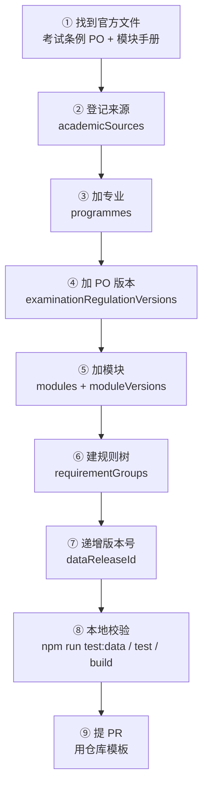

# 贡献指南：补上你所在学院的专业

> 英文版：[ADDING_A_FACULTY.md](ADDING_A_FACULTY.md) · 总览：[CONTRIBUTING.md](../CONTRIBUTING.md)
>
> **不需要会 React，不需要改界面代码。** 你只需要读懂官方条例，然后编辑一个 JSON 文件。

---

## 30 秒看懂

项目的数据全部来自一个文件：[`src/data/academic/academic-data.json`](../src/data/academic/academic-data.json)。
你把官方文件里的事实**转录**进去，界面会自动出现你的专业、模块和要求组。



顺序不能反：后面的记录要引用前面的 ID。

---

## 你能贡献的三种粒度

| 粒度 | 你交付什么 | 耗时 | 适合 |
|---|---|---|---|
| **A. 骨架** | 专业 + PO，没有模块表 | 1–2 小时 | 先让专业出现在列表里，界面会诚实显示「此版本尚未逐条录入」 |
| **B. 单专业完整** | 骨架 + 模块 + 要求组 + 核对 | 4–8 小时 | 最常见、最有价值的 PR |
| **C. 一个系** | 3–5 个 B | 分 3–5 个 PR | 有人愿意长期维护整个系 |

**建议从 B 开始，一次只做一个专业。** 一个做透的专业比五个只有名字的专业更有用。

---

## 开始之前

### 你要准备的文件

| 文件 | 德语名 | 里面有什么 | 必须吗 |
|---|---|---|---|
| 考试条例 | Prüfungsordnung (PO) | 总学分、必修/选修模块、论文、入学学期 | 必须 |
| 模块手册 | Modulhandbuch | 每个模块的 ECTS、考试形式、开课学期 | 做 B 时必须有 |
| 培养计划 | Studienverlaufsplan / Anlage | 每学期上什么课、模块组怎么分 | 做 B 时必须有 |
| 学院专业列表 | — | 该学院有哪些专业 | 建议登记为来源 |

官方条例库：`https://www.doc.zuv.fau.de/`，或从学院/专业的「Prüfungsordnungen」页面进入。

### 三条纪律

1. **不猜。** 看不到的 ECTS 就留 `null`，不确定的规则标 `needs_review`。一个看起来合理的数字比一个空白更危险。
2. **不碰 FAU 系统。** 不需要、也不允许登录 Campo/StudOn 抓数据；只需要公开的 PDF。
3. **不整本上传手册。** 官方条例可以存/引用；模块手册登记 URL + SHA-256 即可，不要提交整本 PDF。

---

## 第 0 步：把项目跑起来

```bash
git clone https://github.com/tommy2345-art/FAU-Studyinfo-Navigator.git
cd FAU-Studyinfo-Navigator
npm ci
npm run dev        # http://127.0.0.1:5173
npm run test:data  # 随时可以跑，检查数据是否自相矛盾
```

数据文件是 [`src/data/academic/academic-data.json`](../src/data/academic/academic-data.json)，用任何编辑器打开即可。建议先看三个生物专业的写法，照着结构抄。

---

## 第 1 步：登记来源（`academicSources`）

先登记文件，再引用它。每条来源都要有 HTTPS 地址和核对日期。

```json
{
  "id": "fau-fpo-physik-2025",
  "title": { "zh-CN": "物理学硕士考试条例（2025）", "en": "Physics M.Sc. examination regulations (2025)" },
  "publisher": "Friedrich-Alexander-Universität Erlangen-Nürnberg",
  "url": "https://www.doc.zuv.fau.de/.../FPO_Physik_2025.pdf",
  "documentType": "examination_regulation",
  "scope": {
    "programmeIds": ["nat-physik-msc"],
    "examinationRegulationVersionIds": ["po-physik-2025"]
  },
  "documentVersion": "2025-08-01",
  "sectionOrPage": null,
  "lastCheckedAt": "2026-10-25",
  "lastVerifiedAt": null,
  "verificationStatus": "needs_review",
  "notes": { "zh-CN": "已逐条录入，等待复核。", "en": "Transcribed, awaiting verification." }
}
```

`documentType` 只能取：`examination_regulation`、`transition_rule`、`module_handbook`、`campo`、`official_notice`、`official_index`。

> 模块手册再登记一条，`documentType` 用 `module_handbook`。**不要**把整本 PDF 提交进仓库；把 URL 和 SHA-256 写进 `documentVersion` 或 `notes`。

---

## 第 2 步：加专业（`programmes`）

```json
{
  "id": "nat-physik-msc",
  "facultyId": "nat",
  "degreeType": "master",
  "name": { "zh-CN": "物理学（硕士）", "en": "Physics (M.Sc.)" },
  "programmeTrackIds": [],
  "examinationRegulationVersionIds": ["po-physik-2025"],
  "dataStatus": "partial",
  "websiteSourceIds": ["fau-physik-programme-page"]
}
```

| 字段 | 说明 |
|---|---|
| `facultyId` | 只能是 `phil` / `wiso` / `med` / `nat` / `tech` |
| `degreeType` | `bachelor` 或 `master` |
| `dataStatus` | `verified`（整专业转录并核对）/ `partial`（进行中）/ `unverified` |
| `programmeTrackIds` | 只有条例真的分方向时才填，见第 6 步 |
| `websiteSourceIds` | 指向已登记的官方专业页，不能是裸 URL |

---

## 第 3 步：加 PO 版本（`examinationRegulationVersions`）

```json
{
  "id": "po-physik-2025",
  "programmeId": "nat-physik-msc",
  "code": "FPO Physik 2025",
  "title": { "zh-CN": "物理学硕士考试条例（2025）", "en": "Physics M.Sc. examination regulations (2025)" },
  "entrySemesterFrom": "2025-winter",
  "entrySemesterUntil": null,
  "applicabilityNotes": {
    "zh-CN": "适用于 2025 冬季学期及以后入学的学生（依 § 54）。",
    "en": "Applies to students enrolled from winter semester 2025 onwards (§ 54)."
  },
  "sourceIds": ["fau-fpo-physik-2025"],
  "verificationStatus": "needs_review"
}
```

要点：

- 入学学期格式固定：`2025-winter`、`2026-summer`。
- **旧版 PO 单独加一条，不要覆盖。** 学生的入学学期决定匹配哪一条。
- 如果旧版还没转录模块表，保留 PO、不建要求组，界面会显示「此版本尚未逐条录入，你的选择仍有效」。

---

## 第 4 步：加模块（`modules` + `moduleVersions`）

模块身份和版本分开，原因很简单：同一条条例改了，模块内容会变，但模块本身还在。

```json
{
  "id": "physik-mod-exp1",
  "programmeIds": ["nat-physik-msc"],
  "name": { "zh-CN": "实验物理 I", "en": "Experimental Physics I" }
}
```

```json
{
  "id": "physik-mod-exp1-v2025",
  "moduleId": "physik-mod-exp1",
  "versionLabel": "FPO Physik 2025, S. 12",
  "validFromSemester": "2025-winter",
  "validUntilSemester": null,
  "applicablePoVersionIds": ["po-physik-2025"],
  "ects": 10,
  "offeringTerms": ["winter"],
  "sourceIds": ["fau-fpo-physik-2025"],
  "verificationStatus": "needs_review"
}
```

| 字段 | 注意 |
|---|---|
| `ects` | 确认不了就写 `null`，**不要写 0** |
| `offeringTerms` | `["winter"]` / `["summer"]` / 两季都有 / 不知道写 `null` |
| `applicablePoVersionIds` | 必须包含这条 PO，否则跨 PO 校验会失败 |
| `versionLabel` | 写到页码，方便复核 |

---

## 第 5 步：把培养计划变成规则树（`requirementGroups`）

这是学生实际看到的部分。**一行培养计划 = 一个组。**

### 映射表

| 培养计划里的行 | `kind` | `minEcts` / `maxEcts` | `eligibleModuleVersionIds` |
|---|---|---|---|
| 总计 120 ECTS | `mandatory` | 120 / 120 | **空数组**（根组不带模块） |
| Pflichtmodule 45 ECTS | `mandatory` | 45 / 45 | 这 45 学分对应的全部模块 |
| Wahlpflichtbereich 30 ECTS | `restricted_elective` | 30 / 40 | 该组可选的全部模块 |
| 自由选修（任意模块） | `free_elective` | 该块学分 | **空数组**（空表示任意） |
| 硕士论文 30 ECTS | `thesis` | 30 / 30 | 论文模块版本 |
| 必修实习 | `internship` | 按条例 | 空数组或实习模块 |
| 关键能力/软技能 | `additional` | 按条例 | 列出的模块 |

### 根组

```json
{
  "id": "rg-physik-gesamt",
  "examinationRegulationVersionId": "po-physik-2025",
  "programmeTrackIds": [],
  "parentRequirementGroupId": null,
  "name": { "zh-CN": "硕士总学分", "en": "Master total" },
  "kind": "mandatory",
  "ruleText": { "zh-CN": "总计 120 ECTS，其中必修 45、选修 45、论文 30。", "en": "120 ECTS total: 45 mandatory, 45 elective, 30 thesis." },
  "minEcts": 120,
  "maxEcts": 120,
  "eligibleModuleVersionIds": [],
  "exclusiveCounting": false,
  "sourceIds": ["fau-fpo-physik-2025"],
  "verificationStatus": "needs_review"
}
```

### 子组

```json
{
  "id": "rg-physik-pflicht",
  "examinationRegulationVersionId": "po-physik-2025",
  "programmeTrackIds": [],
  "parentRequirementGroupId": "rg-physik-gesamt",
  "name": { "zh-CN": "必修模块", "en": "Mandatory modules" },
  "kind": "mandatory",
  "ruleText": { "zh-CN": "以下模块全部必修。", "en": "All modules below are mandatory." },
  "minEcts": 45,
  "maxEcts": 45,
  "eligibleModuleVersionIds": ["physik-mod-exp1-v2025", "physik-mod-exp2-v2025"],
  "exclusiveCounting": false,
  "sourceIds": ["fau-fpo-physik-2025"],
  "verificationStatus": "needs_review"
}
```

**根组的子组最低学分之和必须等于根组**：45 + 45 + 30 = 120。`npm run test:data` 会检查。

### 三选二 / 分方向

如果条例是「从三个模块组里选两个」，正确结构是：

```text
根组 120
├── 模块组对 (65)          ← 父组，本身不带模块
│   ├── MG1 (30–40)        ← 绑定 track 1
│   ├── MG2 (30–40)        ← 绑定 track 2
│   └── MG3 (30–40)        ← 绑定 track 3
└── 统计+深化+论文 (55)
```

- 三个 MG 组分别建一条 `programmeTracks` 记录；
- 每个 MG 组只在 `programmeTrackIds` 里挂**自己**的 track；
- 如果三个组都挂到同一个 track，学生选两个组会把第三组的模块也算进去——ILS 项目真实踩过这个坑。

---

## 第 6 步：递增数据版本

文件顶部：

```text
"dataReleaseId": "2026-10-24.2"   →   "2026-11-01.1"
```

`createdAt` 不要改。

---

## 第 7 步：本地校验

```bash
npm run test:data   # 引用完整性、PO 区间、根组算术、组内可达性
npm run test        # 静态 34 项 + 单元测试
npm run build
```

通过时输出：

```text
OK   rg-physik-gesamt: total 120-120, children 120-120
OK   rg-physik-pflicht: needs 45, offers 45
ALL CHECKS PASSED
```

### 报错对照表

| 报错 | 原因 | 怎么修 |
|---|---|---|
| `rg X -> unknown moduleVersion Y` | 引用了不存在或拼错的模块版本 ID | 检查 ID 是否已在 `moduleVersions` 里 |
| `rg X -> unknown parent` | 父组 ID 写错 | 改成正确的组 ID，根组用 `null` |
| `po X -> unknown programme` | PO 的 `programmeId` 写错 | 对齐专业 ID |
| `source X not https` | 来源不是 HTTPS | 换成官方 HTTPS 地址 |
| `rg-root: total 120-120, children 115-115` | 子组最低学分加起来不等于根组 | 调整某个子组的 `minEcts` |
| `rg X: needs 55, offers 50` | 组里的模块学分总和不够门槛 | 补模块或修正门槛（先核对原文） |
| `Required` / `Expected string` | 缺字段 | 按上面的字段表补齐 |
| 界面列表里没有你的专业 | 专业不在对应 `facultyId` + `degreeType` 下 | 检查这两个字段 |

> 校验失败先改数据，不要改测试。测试只固定「三个生物专业」和结构不变量，加新学院不需要动它。

---

## 第 8 步：提 PR

```bash
git checkout -b add-physik-msc
git add src/data/academic/academic-data.json
git commit -m "Add the Physics M.Sc. skeleton from the 2025 FPO"
git push -u origin add-physik-msc
```

在 PR 描述里写清楚四件事（模板会自动提示）：

1. 哪个学院、哪个专业、哪条 PO；
2. 用了哪两份官方文件（链接 + 版本日期）；
3. 哪些页码你手工核对过；
4. **还有什么没转录**。

CI 会自动跑：typecheck、lint、数据校验、单元测试、构建、E2E。全绿就可以等评审。

---

## 常见问题

**Q：我只有条例，没有模块手册，能先加吗？**
能。只加 `programme` + `PO`（骨架 A）。界面会列出专业并显示「此版本尚未逐条录入」，不会误导学生。

**Q：我学院有十几个专业，要一次做完吗？**
不要。一个专业一个 PR。评审一个 300 行的数据改动是可行的，评审一个 3000 行的改动不可行。

**Q：课程名要不要翻成中文？**
保留德语/英语官方原名，再加中文说明。`name` 里两个语言键都必须有值。

**Q：旧版 PO 还有人用，要删吗？**
不删。单独加一条，设置 `entrySemesterUntil`，让老生匹配旧版。

**Q：可以直接改界面文案吗？**
不需要。数据驱动界面，覆盖率、空状态、模块清单都会自动更新。

**Q：别的学校能用吗？**
目前 schema 固定 FAU 五个学院（`phil`/`wiso`/`med`/`nat`/`tech`），其他学校需要改代码，不在「加数据」范围内。

**Q：我怕做错，可以先只提资料吗？**
可以。用「我的学院缺失」issue 模板，把官方链接和版本发出来，别人可以接手。

---

## 字段速查

| 数组 | 必填字段 |
|---|---|
| `academicSources` | `id`、`title`、`publisher`、`url`(https)、`documentType`、`scope`、`lastCheckedAt`、`verificationStatus` |
| `programmes` | `id`、`facultyId`、`degreeType`、`name`、`dataStatus`、`websiteSourceIds` |
| `examinationRegulationVersions` | `id`、`programmeId`、`code`、`title`、`applicabilityNotes`、`sourceIds`、`verificationStatus` |
| `modules` | `id`、`programmeIds`、`name` |
| `moduleVersions` | `id`、`moduleId`、`versionLabel`、`applicablePoVersionIds`、`ects`、`sourceIds`、`verificationStatus` |
| `requirementGroups` | `id`、`examinationRegulationVersionId`、`parentRequirementGroupId`、`name`、`kind`、`ruleText`、`minEcts`、`maxEcts`、`sourceIds`、`verificationStatus` |

状态取值：`verified` / `tentative` / `needs_review` / `unverified` / `conflict`。

---

## 需要帮助

- 不确定结构：先看三个生物专业的写法（`nat-biologie-*`），它们是最完整的参考。
- 不知道从哪开始：开一个「我的学院缺失」issue，写清楚学院、专业、你找到的官方链接。
- 发现已有数据错了：用「Wrong academic data」模板，附官方链接和页码。

**再次提醒：不要猜。** 空白是诚实的，猜出来的数字会让学生按错误计划选课。
