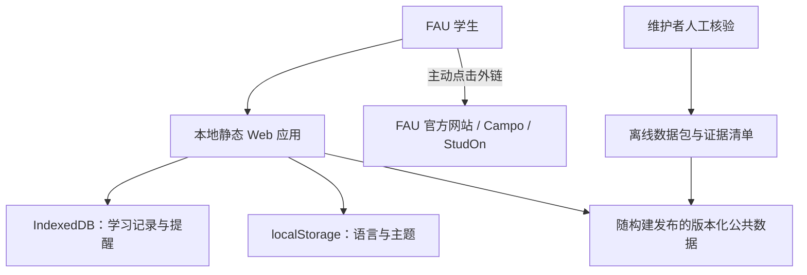

# FAU Study Navigator 架构设计

## 1. 架构目标与范围

FAU Study Navigator 是本地部署、静态优先的单页应用。它帮助 FAU 学生导航官方入口、按专业与 Prüfungsordnung（PO）版本理解已核实的要求、手动规划学期和记录提醒，但不代替 Campo、StudOn 或正式考试条例。

本设计覆盖 P0–P6 的目标架构，不包含本轮 UI 实现。核心约束如下：

- 无生产后端、无账号、无云数据库、无在线 API、无自动远程采集。
- 运行时个人数据只保存在浏览器本地。
- 公共学术数据随静态构建以版本化数据包交付，并经过人工核验。
- 默认简体中文，英文功能与内容键完整等价。
- 所有结论以专业、入学学期和 PO 版本为边界；不确定性是模型的一部分。

## 2. 系统上下文



应用不向 FAU 或其他远程服务发起数据请求。官方网页仅作为用户主动打开的外部导航和维护者人工核验依据；浏览器中的学习记录不会附加到外链或上传。

## 3. 逻辑分层

| 层 | 职责 | 禁止事项 |
|---|---|---|
| Presentation | 路由、响应式布局、可访问交互、状态标签、双语文本 | 在组件中硬编码 ECTS 或毕业判断 |
| Application | 用例编排、onboarding、筛选、备份恢复、提醒与 ICS 导出 | 绕过 schema 直接写存储 |
| Domain | PO 解析、ECTS 计算、需求分组、截止日期适用性、冲突与 unknown 传播 | DOM、网络、IndexedDB 依赖 |
| Data access | Zod 校验、公共数据仓库、Dexie 仓库、偏好与迁移 | 把个人数据写回公共数据 |
| Static data | 学院、资源、来源、专业、PO、模块、期限的版本化 JSON | 无来源或伪造的正式数值 |

建议目录（实现阶段创建）：

```text
src/
  app/                 # 路由、providers、启动检查
  components/          # 布局、基础控件、通用状态组件
  features/            # onboarding、dashboard、requirements、planner 等
  domain/              # schemas、纯规则引擎、日期与适用性判断
  data/                # 只读公共数据与仓库适配器
  storage/             # IndexedDB、偏好、迁移、备份
  i18n/                # zh-CN / en 资源
  lib/                 # 无领域含义的工具
tests/
  unit/
  integration/
  e2e/
  fixtures/
scripts/               # 仅本地校验、打包和审计
docs/
```

## 4. 核心领域模型

所有 schema 由 Zod 定义并导出推导类型。标识符稳定且不可复用；显示名称可本地化。

### 4.1 专业与 PO 解析键

```text
StudyProfile =
  degreeType
  + facultyId
  + programmeId
  + entrySemester
  + poVersionId (用户确认)
  + optionalTrackIds
```

- `Programme` 从属于一个 Faculty，但要求不从 Faculty 直接推导。
- `PoVersion` 从属于一个 Programme，具有有效期、适用 cohort 说明和来源。
- `entrySemester` 仅用于筛选候选 PO，不可替用户自动确认。
- 无已核实 programme/PO 时进入 General Mode；导航、个人规划与提醒可用，毕业要求判断为 `unknown`。

### 4.2 数据实体

| 实体 | 关键字段/规则 |
|---|---|
| `Source` | URL、发布者、文档类型、适用专业/PO/学期、文档页码或章节、`lastCheckedAt`、`lastVerifiedAt`、校验状态 |
| `Programme` | faculty、degree type、支持的 PO、`verified | partial | placeholder` |
| `PoVersion` | programme、code、effective range、cohort notes、sourceIds |
| `RequirementGroup` | kind、min/max ECTS、eligible module versions、互斥/包含关系、前置条件、状态、sourceIds |
| `ModuleVersion` | moduleId、versionId、有效学期、ECTS 可空、开课状态、sourceIds |
| `StudentModuleRecord` | moduleVersionId、plannedSemester、creditStatus、examRegistration、recognizedEcts、更新时间 |
| `Deadline` | Berlin 本地日期时间、scope、target、status、sourceIds、核验时间 |
| `UserReminder` | 本地标识、关联目标、触发时间、用户文本；不得伪装为官方期限 |

### 4.3 状态与三值结果

- 验证状态：`verified | tentative | needs_review | unverified | conflict`。
- 学分状态：`planned | in_progress | passed | failed | recognized`。
- 考试报名：`unknown | not_registered | user_marked_registered | attended | cancelled`，全是用户自报，不代表 Campo 确认。
- 规则结果：`satisfied | not_satisfied | unknown`。只要 required ECTS、子规则、来源适用性或冲突无法确认，最终结果不得从 `unknown` 提升为已满足。

## 5. 学分与需求引擎

引擎为确定性的纯函数，输入为：选定的 programme/PO、已验证 requirement graph、module versions、用户记录；输出为：earned/planned 汇总、每组分配、未决条件、警告和三值结论。

处理顺序：

1. 校验输入 schema 和 PO 归属。
2. 将记录绑定到准确 `moduleVersionId`；版本缺失或歧义则标记待审查。
3. earned 只接受 `passed`，以及带用户确认与有效数值的 `recognized`。
4. 合并同一模块的多次尝试，避免重复计算；失败记录保留但不计分。
5. 按 requirement graph 分配，互斥组只能分配一次；上层组从子组聚合，不重新计分。
6. 若规则完整且无冲突，才输出 satisfied/not_satisfied；否则输出 unknown 与原因码。

PO 切换不删除学习记录。新 PO 下重新映射，无法映射的课程进入“待重新归类”。

## 6. 日期、时区与 ICS

- 官方日期存储为 ISO local date/time 加固定 `timezone: Europe/Berlin`，而不是预先换算成访问者时区的 UTC 文本。
- 全天日期与有时刻的事件分开建模，避免 DST 或 UTC 转换导致跨日。
- 展示层明确显示 Berlin 时区和 `tentative/confirmed/unknown` 标签。
- 专业级 deadline 仅在 programme/PO/scope 匹配时显示“适用于你”；其他信息标为通用并要求核对。
- ICS 使用稳定 UID（基于本地实体 ID，而非标题），转义文本并去重；导出行为完全本地完成。

## 7. 存储与迁移

| 存储 | 内容 | 生命周期 |
|---|---|---|
| 构建内 JSON | 公共导航、来源、专业/PO/规则/日期 | 只读，随应用版本更新 |
| IndexedDB（原生 API） | 学习记录、计划、个人考试、学习任务、已确认的 PO | 本机持久化，可导入/导出/清空 |
| localStorage | `locale`、主题、低敏界面偏好 | 本机持久化，可重置 |
| 内存 | 视图筛选、临时表单、解析中的导入包 | 页面会话 |

备份包须包含 `schemaVersion`、`exportedAt`、`appVersion`、payload 和可选的本地完整性摘要。导入采用“解析 → schema 校验 → 大小/条目上限 → 预览 → 用户确认 → 单事务写入”的流程。失败不得污染现有数据。彻底清空需二次确认，并同时清除 IndexedDB 和本应用命名空间下的 localStorage。

## 8. 公共数据治理

公共数据包按 `dataReleaseId` 版本化，变更全部在本地完成：

1. 维护者人工访问官方来源并保存必要的引用元数据；不由应用或脚本远程抓取。
2. 在本地工作副本录入候选数据，附专业、PO、有效期、页码/章节和核验人检查项。
3. 运行离线 schema、引用完整性、ID 唯一性、范围冲突和翻译覆盖检查。
4. 第二人或独立复核步骤确认后，才将状态设为 `verified`。
5. 不能确认、页面变化或来源冲突时保留旧记录并降级为 `needs_review/conflict`；不得自动覆盖。

P0–P6 不建设远程监控器或自动爬虫。未来若政策改变，须作为独立提案，经隐私、法律、robots 和用户授权评审，不得默认加入。

## 9. 国际化与可访问性

- `zh-CN` 为稳定默认值；首次启动不得因浏览器为英文而悄悄改变默认，只能提供切换建议。
- `en` 与 `zh-CN` 使用相同消息键；CI/本地脚本检查键集合一致、无空值、无直接硬编码用户文案。
- 专业、法规、模块的官方名称可保留德文，并提供经核实的中文/英文辅助说明；翻译不能改变法律含义。
- 语义 HTML、可见焦点、键盘全流程、跳转链接、表单错误关联、状态不只依赖颜色；目标遵循 WCAG 2.2 AA 基础要求。

## 10. 安全与本地部署

- 构建产物由本机静态服务器提供，例如 `npm run build` 后通过本地 preview/静态服务器访问；不部署到公网。
- 不使用 CDN、第三方字体、远程图片、分析 SDK、错误上报 SDK、service worker 远程缓存源。
- CSP 默认 `default-src 'self'; connect-src 'self'; img-src 'self' data:; font-src 'self'; object-src 'none'; base-uri 'self'; form-action 'self'`。若完全无同源 API，可进一步令 `connect-src 'none'`，需验证开发与生产差异。
- 外链使用允许协议校验、明确域名/目标提示，并在新标签打开时加 `noopener noreferrer`。
- JSON 导入按不可信输入处理；不得执行 HTML、脚本、公式或任意 URL 协议。

## 11. 关键架构决定

| 决定 | 理由 | 代价 |
|---|---|---|
| 静态单页应用，无后端 | 符合本地部署与隐私要求 | 无跨设备同步 |
| 公共数据随构建发布 | 可复现、可离线、易审计 | 更新需要重新构建 |
| 专业 + PO 版本为规则边界 | 避免把学院级信息误当专业要求 | 数据录入更严格 |
| 纯领域引擎 + 三值结果 | 可测试且避免伪确定性 | UI 需解释 unknown 原因 |
| IndexedDB 保存学习记录 | 容量与事务优于 localStorage | 需迁移与兼容测试 |
| 无自动远程采集 | 满足本轮约束并降低错误发布风险 | 来源新鲜度依赖人工流程 |

