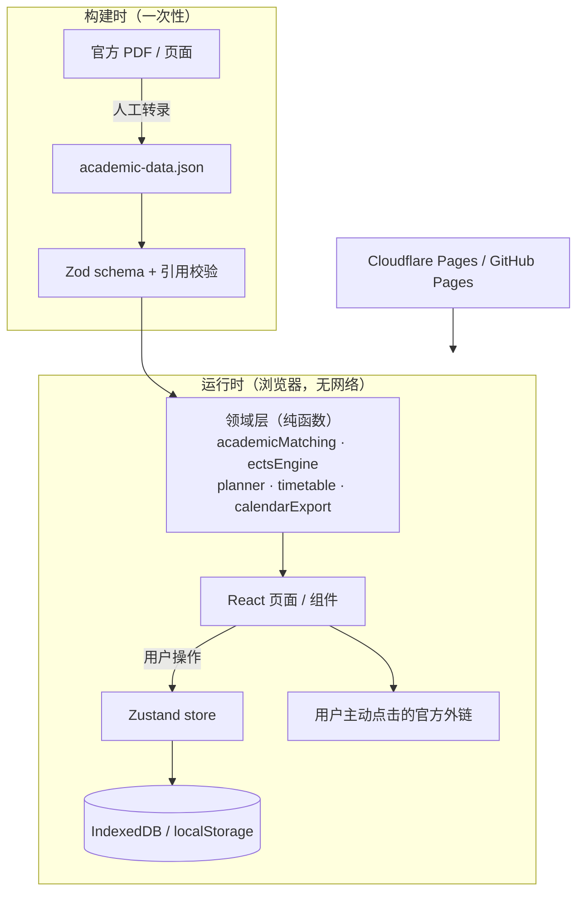
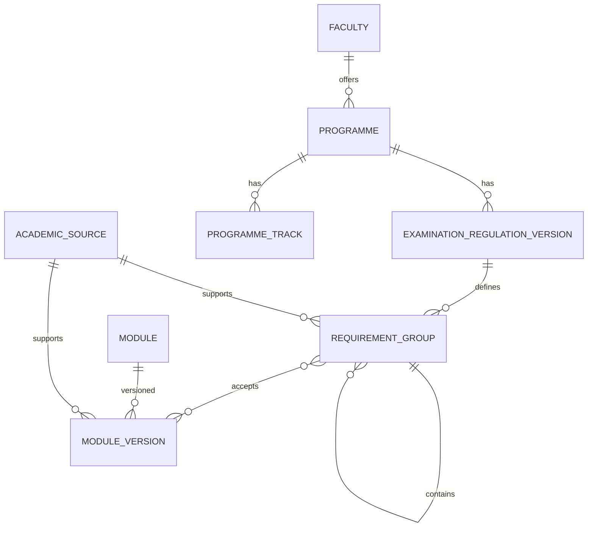

# 项目设计

这份文档回答三个问题：**它为什么这样搭、数据怎么流动、以后怎么扩。**

## 1. 目标与非目标

**目标**

- 让 FAU 学生在一个本地应用里查到**已核实**的专业规则、模块、ECTS 与常用入口。
- 每条学术结论都能回溯到官方文件的具体页码。
- 记录只属于用户自己的浏览器。
- 其他学院能靠**加数据**接入，不需要改界面。

**非目标**

- 不做 FAU 官方服务，不代替 Campo。
- 不做账号、云同步、后端、遥测。
- 不自动抓取 FAU 系统，不接触 FAU 凭据。
- 不在数据缺失时“猜一个看起来合理”的值。

## 2. 总体架构



分层职责：

| 层 | 位置 | 规则 |
| --- | --- | --- |
| 数据契约 | `src/domain/academic.ts` | Zod 是唯一真源，TypeScript 类型从 schema 推导 |
| 领域逻辑 | `src/domain/*.ts` | 纯函数，不 import React，不读浏览器 API（时间/日历除外） |
| 状态 | `src/store/*.ts` | Zustand；只负责编排与持久化，不做学分判断 |
| 页面 | `src/features/*` | 渲染与交互；不硬编码 PO 或学分 |
| 数据包 | `src/data/academic/academic-data.json` | 只读、版本化；界面文案在 `i18n` |

## 3. 数据模型



几个容易误解的点：

- **Module 与 ModuleVersion 分开**：模块是身份，版本是“某条 PO 下的内容”。条例改版时新增版本，旧版本保留给老生。
- **RequirementGroup 是树**：根组代表总学分（如 120），子组代表必修、选修、论文。父组自身通常没有模块，学分由子组汇总。
- **AcademicSource 是证据**：规则和模块版本都必须挂来源；`verificationStatus` 决定界面徽章。
- **ProgrammeTrack**：只在条例真的分方向时使用；模块组必须绑定自己的 track，避免串组计分。

## 4. 关键设计决策

| 决策 | 理由 | 代价 |
| --- | --- | --- |
| 本地优先，无后端 | 隐私、零运营成本、离线可用 | 换设备要手动备份；没有多端同步 |
| 静态数据包随构建发布 | 无运行时抓取，来源可审计 | 条例更新需要重新发版 |
| PO 版本化，且必须用户确认 | 入学学期决定适用版本，系统不能替学生选“最新” | 多一步操作；旧版缺数据时要诚实提示 |
| 未知值保持 `null` | 看起来合理的错数字比空白更危险 | 部分专业暂时无法算毕业 |
| 覆盖率由数据推导 | 加数据即生效，界面不会撒谎 | 需要结构不变量测试兜底 |
| 父组汇总子组学分 | 学生只需面对模块级要求 | 引擎实现比“逐组独立”复杂 |
| 规则与界面分离 | 新增学院不改 React | 数据结构对贡献者有一定学习成本 |
| 无 Cookie / 无分析 | 不需要同意弹窗，符合隐私最小化 | 无法知道用户怎么用，只能靠 issue |

## 5. 数据流

**发布时**

1. 维护者读官方 PDF，登记来源。
2. 转录专业、PO、模块、模块版本、要求组。
3. `npm run test:data` 校验引用、PO 区间、根组算术、组内可达性。
4. Vite 构建时由 Zod 再做一次全量校验；坏包直接构建失败。
5. 部署到 Cloudflare Pages（GitHub Pages 为镜像）。

**运行时**

1. 用户选择专业与 PO（INDEXEDDB `academic-profile` 保存选择）。
2. 页面用 `getRequirementGroupsForSelection` 取出适用的规则树。
3. 用户加课；`calculateEctsProgress` 计算已得/计划学分与风险。
4. 所有个人记录写入 IndexedDB；数据包保持只读。

## 6. 安全与隐私设计

- 严格 CSP：`default-src 'self'`，无 CDN、无远程字体、无远程脚本。
- 静态测试禁止 `fetch` / `XHR` / `WebSocket` / `sendBeacon` / `document.cookie` / 已知分析脚本。
- 外链只允许 `https:`，用户点击才离开；`rel="noopener noreferrer"`。
- 备份导入做大小、深度、schema 与冲突校验，不静默覆盖。
- 无账号体系，不接触 FAU 凭据；详见 [LEGAL.md](../LEGAL.md)。

## 7. 怎么扩展

加一个学院/专业只需要数据：

1. 在 `academicSources` 登记官方文件；
2. 加 `programmes`、`examinationRegulationVersions`；
3. 加 `modules`、`moduleVersions`；
4. 建 `requirementGroups` 树；
5. 递增 `dataReleaseId`，跑门禁。

界面、覆盖率、空状态都会自动适配。详细步骤见
[ADDING_A_FACULTY.zh-CN.md](ADDING_A_FACULTY.zh-CN.md)。

## 8. 目录结构

```text
src/
├── app/          路由与入口
├── components/   布局与通用组件
├── data/         数据包、覆盖率推导、资源种子
├── domain/       纯函数：匹配、ECTS、课程表、时区、ICS
├── features/     六个页面 + 法律声明
├── i18n/         中英文案（键集必须对等）
├── storage/      IndexedDB / localStorage / 备份
├── store/        Zustand 状态
└── test/         Vitest setup
tests/
├── static.test.mjs   静态合规检查（35 项）
└── e2e/              Playwright 冒烟
```

## 9. 已知取舍

- 学期分布（第 1–4 学期）尚未建模；当前用要求组 + ECTS 表达结构。
- 考试形式（Klausur / mündliche Prüfung）未入库。
- 旧版 PO 只有已获取原文的才转录；其余显式标记为未转录。
- ECTS 引擎不会替用户“寻找可行分配”，分配由用户选择组决定。
- 学术数据没有逐字段证据（RuleEvidence），PDF 改版后无法自动 diff。
