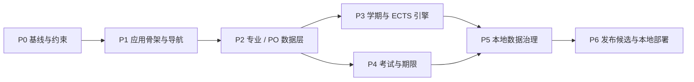

# FAU Study Navigator P0–P6 开发计划

## 1. 计划说明

本计划把项目拆为七个可验收阶段。当前只完成规划文档，不开始 UI 编码。后续每次只进入经用户明确批准的阶段；所有构建、测试、数据维护与部署均在当前本地目录完成。

### 全局完成定义

每个阶段都必须：

- 不引入远程运行时依赖、在线 API、云数据库、遥测或自动数据采集。
- 不包含未经核实却伪装成真实的 FAU 学术数据。
- 中英文消息键完整，默认简体中文。
- 完成本阶段列出的自动化测试，并通过当时可用的 lint、typecheck、unit、integration、e2e、build 门禁。
- 更新相关文档、数据版本和已知限制；保留原始 PRD。

## 2. 依赖关系

P3 与 P4 可在 P2 验收后并行设计，但 P5 必须整合两者的数据迁移、备份与审计能力；P6 依赖全部前置阶段。

## 3. P0 — 项目基线与规划冻结

**目标：** 建立不含 UI 实现的可信开发基线，解决 PRD 与本次本地约束的冲突。

**任务**

- 保存并完整审阅 `upload/PRD(1).md`，建立需求追踪表。
- 建立 `AGENTS.md`、架构、开发计划、数据政策和测试计划。
- 定义范围：本地静态应用、无后端、无远程抓取、无远程发布。
- 建立术语表和核心不变量：PO、ECTS、earned、recognized、tentative、verified、General Mode。
- 记录风险：学术数据真实性、PO 适用范围、时区、双计、迁移和翻译漂移。

**依赖：** 原始 PRD 和用户本轮约束。

**交付成果**

- 五份规划文档。
- P0–P6 阶段图、数据边界和质量门禁。
- 明确的非目标与设计决定。

**验收标准**

- 五份文档均存在且内部术语一致。
- 每个阶段都列有任务、依赖、交付物、验收标准和自动化测试。
- 文档明确禁止伪造学术数据、远程 API/采集、云数据库和远程 Git 操作。
- `upload/PRD(1).md` 保持原样存在。
- 自动化检查：Markdown 链接/标题/格式本地检查脚本（P1 建立）可纳入回归；P0 先进行文件存在性和内容关键词检查。

## 4. P1 — 本地应用骨架、导航与国际化

**目标：** 创建可本地运行的静态骨架和六项主导航，不录入专业学术规则。

**任务**

- 初始化 Vite + React + TypeScript strict；配置 lint、格式、类型检查、Vitest、Testing Library、Playwright。
- 建立路由、响应式 shell、错误边界、404、离线友好的静态资源策略。
- 建立 `zh-CN` 默认和完整 `en` 语言资源、语言切换与缺失键检查。
- 创建六个页面的语义骨架、独立项目免责声明和外链安全组件。
- 建立五学院基础枚举；只使用 PRD 已列明且不涉及规则推断的通用信息。
- 配置本地开发、测试、构建和本地 preview 命令；不创建远程 CI 或部署配置。

**依赖：** P0。

**交付成果**

- 可启动的本地静态应用骨架。
- 响应式导航、双语框架、错误/空状态、免责声明。
- 本地质量脚本和测试基础设施。

**验收标准**

- 首次加载默认中文，一键切换英文后所有可见文案完整切换且刷新保留。
- 320px 宽度至桌面布局无水平溢出，六项主导航可用键盘访问。
- 页面不发起任何远程网络请求；构建产物不引用 CDN、远程字体或远程脚本。
- 外链组件只允许 `https:` 且明确提示将离开应用；无 `_blank` opener 风险。
- 自动化测试：路由 smoke、i18n 键对等、默认语言、键盘导航、移动视口、无意外网络请求、生产 build。

## 5. P2 — Onboarding、专业/PO 版本与来源模型

> 范围更新（2026-10-22）：用户明确将本轮 P2 定义为 **FAU Resources Navigator**。本轮实现五学院/学位筛选、资源搜索、收藏、本地个人网站及自定义分类；下述原定专业/PO onboarding 任务顺延，仍不得用资源筛选替代 PO 选择或学术规则核验。

**目标：** 建立按专业和 PO 版本工作的数据契约及首次使用流程，未核实专业进入 General Mode。

**任务**

- 用 Zod 定义 Faculty、Programme、PoVersion、Source、ModuleVersion、RequirementGroup 与验证状态。
- 实现 Bachelor/Master → 学院 → 专业 → 入学学期 → PO 的向导；PO 必须由用户确认。
- 实现 General Mode 和“Not verified for your program”状态，禁止自动套用最新 PO。
- 建立本地只读数据仓库、数据版本和引用完整性校验器。
- 建立 Sources & Updates 页面所需的来源、有效范围、核验状态展示模型。
- 只录入已确认的基础结构；任何演示数据必须醒目标记 synthetic，且不能参与正式结论。

**依赖：** P1 的路由、i18n、测试和静态数据加载能力。

**交付成果**

- 版本化 schema 与本地数据包格式。
- Onboarding 与 General Mode。
- 来源证据面板和本地数据校验命令。

**验收标准**

- 用户不能在未确认 PO 时得到毕业要求判断；切换专业/PO 要求明确确认。
- Programme 与 PoVersion 的归属和有效范围必须通过 schema 与交叉引用检查。
- 未支持的专业仍可使用通用导航，但所有专业规则显示 unknown/unverified。
- 每条正式规则可追溯到至少一个适用 Source；冲突不得静默覆盖。
- 自动化测试：完整 onboarding、General Mode、PO 候选筛选、错误组合、刷新持久化、中英文全流程、schema/引用校验。

## 6. P3 — 学期规划与 ECTS 规则引擎

> 范围更新（2026-10-22）：用户明确将本轮 P3 定义为 **FAU Academic Data Model**。本轮先实现 Faculty、DegreeType、Programme、ProgrammeTrack、EntrySemester、ExaminationRegulationVersion、Module、ModuleVersion、RequirementGroup、AcademicSource、RuleVerificationStatus，本地 JSON 校验，以及专业/PO 选择和规则来源界面。下述学期规划、ECTS 引擎和课程记录任务顺延；本次不创建任何虚构课程或学分数据。

**目标：** 允许学生本地规划课程，并在已核实规则范围内提供可解释的 ECTS 进度。

**任务**

- 实现 StudentModuleRecord、学期计划、目标 ECTS 和本地课程条目。
- 实现纯函数 requirement engine：状态过滤、重复尝试合并、互斥组分配、上层聚合、unknown 传播。
- 区分 planned、enrolled、passed、failed、recognized；考试报名独立。
- 处理 moduleId 相同但 moduleVersionId 不同、PO 切换与待重新归类。
- 构建规划视图、规则来源解释、警告和不确定原因列表。
- 用 IndexedDB/Dexie 持久化，加入初始迁移测试。

**依赖：** P2 的专业/PO、模块、要求组和来源 schema。

**交付成果**

- 纯领域 ECTS/requirements engine。
- 学期规划与需求进度功能。
- IndexedDB 仓库、迁移 v1 和完整 fixture 集。

**验收标准**

- 20 planned + 5 passed 的 earned 为 5，不是 25。
- 同一 6 ECTS 模块进入两个互斥池时总计仍为 6。
- recognized 仅在用户确认且 ECTS 有效时计入；failed/enrolled/examRegistered 不计入。
- 规则或来源不完整时不显示“预计满足毕业要求”，结果为 unknown 并说明原因。
- PO A 切换到 PO B 不丢记录，但按 B 重算并标记无法映射条目。
- 自动化测试：上述边界、重复尝试、最大/最小 ECTS、嵌套组、空目录、冲突来源、迁移和存储失败。

## 7. P4 — 考试、截止日期、提醒与 ICS

> 范围更新（2026-10-22）：用户明确将本轮 P4 定义为 **ECTS Engine & Semester Planner**。本轮实现顺延自原 P3 的本地课程、重修记录、纯 ECTS/要求组引擎、IndexedDB v2 和学期规划交互；下述考试、截止日期、提醒与 ICS 任务继续顺延，不视为已完成。

**目标：** 在范围和可信度明确的前提下展示官方日期，并提供完全本地的个人提醒。

**任务**

- 实现 Deadline、UserReminder、考试报名自报状态和适用性过滤。
- 对 `university | faculty | programme | module` 逐层匹配，区分“适用于你”和“通用信息”。
- 实现 Europe/Berlin 日期解析、显示、DST 处理、时间线与本地提醒。
- 实现本地 ICS 导出、稳定 UID、转义和重复事件消除。
- 若采用 PRD 中 WiSe 2026/27 报名窗口，必须保留其截至 2026-10-21 的 `tentative` 标签和来源；不得推断为 confirmed。
- 清楚声明报名状态为用户手动标记，不代表 Campo 已完成报名。

**依赖：** P2 的 Source/PO/scope 模型；复用 P1 国际化和 P3 本地存储接口。

**交付成果**

- 范围感知的时间线、提醒、报名清单和 ICS 导出。
- Berlin 时区工具与日期 fixture。

**验收标准**

- tentative 事件无论日期多近都不会自动变为 confirmed。
- programme 专属期限不会显示给其他 programme 为“适用于你”。
- 用户勾选报名后仅显示“用户已标记”，不出现“Campo 已报名成功”。
- DST 起止边界、全天事件和带时刻事件显示正确；ICS 重复导出 UID 稳定且事件不重复。
- 自动化测试：scope 矩阵、状态标签、Berlin DST、ICS 语法/转义/去重、提醒权限缺失和不支持环境。

## 8. P5 — 本地数据治理、备份恢复与隐私控制

> 范围更新（2026-10-22）：用户将本轮 P5 定义为 **Exams & Personal Study Tasks**。本轮交付个人考试、课程关联、手动报名状态、学习任务、Europe/Berlin 时间线、ICS 导出，以及版本化 JSON 备份/合并恢复。未录入任何官方考试或报名日期；原计划中的彻底清空、公共数据审核模板和完整隐私设置继续顺延至后续工作。

**目标：** 让个人数据可控、可迁移、可彻底删除，并使公共数据更新保持离线可审计。

**任务**

- 实现带 schemaVersion 的 JSON 导出、导入预览、单事务恢复和错误回滚。
- 实现彻底清空、二次确认、完成回执，以及 IndexedDB/localStorage 一致清理。
- 完成本地数据包校验：ID、引用、范围、翻译键、来源状态、日期和重复记录。
- 建立人工数据更新清单与双重复核规则；禁止自动抓取和自动发布学术数值。
- 完成隐私说明、数据保留说明、威胁模型和依赖审计流程。
- 对日志和错误信息做数据最小化，不输出学习记录正文。

**依赖：** P3 个人学习数据、P4 提醒/期限数据、P2 公共 schema。

**交付成果**

- 本地备份/恢复/清空功能。
- 离线公共数据验证命令和人工审核模板。
- 隐私设置与数据政策页面。

**验收标准**

- 导出后清空，再导入可恢复等价状态；语言/主题是否随包导入必须符合明确选项。
- 无效、超大、未来 schema、损坏或恶意 JSON 不改变现有数据。
- 清空后重启不再出现旧 ECTS、提醒、自定义链接或 PO 选择。
- 公共数据变更没有来源或适用 PO 时校验失败；自动化不能把记录提升为 verified。
- 自动化测试：往返、事务回滚、迁移链、清空、XSS payload、prototype pollution、超限文件、日志脱敏。

**本轮实际验收补充**

- 个人考试和学习任务可增删改并保存到 IndexedDB v3，考试可关联用户已有课程。
- 报名状态只显示为个人记录，不出现已由 Campo 验证或代报名成功的语义。
- Europe/Berlin 春季不存在时刻被拒绝，秋季重复时刻给出提示；时间线不受访问者系统时区改变。
- ICS 在本地生成，使用 Berlin `VTIMEZONE`、稳定 UID、CRLF、字符转义与去重。
- JSON 导入限制大小和嵌套，校验 schema/版本，确认后以跨对象仓库单事务合并；同 ID 内容冲突时不覆盖。

## 9. P6 — 发布候选、可访问性与本地部署

> 质量审查记录（2026-10-22）：已完成源码、学术数据、隐私、网络和静态资源审计，并补充本地清空与 Playwright E2E 配置。无依赖静态/领域测试通过；由于当前目录没有 `node_modules`，ESLint、TypeScript、完整 Vitest、Playwright 和生产构建未能启动。P6 仍为有条件未通过，详见 `docs/P6_ACCEPTANCE_REPORT.md`。

**目标：** 形成可复现、可审计、仅本地运行的首个发布候选。

**任务**

- 完整运行 lint、typecheck、unit、integration、e2e、build 和本地 preview smoke。
- 审核所有学术数值、状态、来源、PO 适用性和免责声明；移除或降级无法证明的内容。
- 完成 WCAG 2.2 AA 基础审计、键盘、屏幕阅读器语义、缩放和响应式检查。
- 验证生产包没有远程请求、CDN、source map 隐私泄露或未使用秘密。
- 编写本地安装、构建、启动、备份、升级、回退与故障排查说明。
- 生成本地发布清单、已知限制和测试证据；不发布到任何远程平台。

**依赖：** P0–P5 全部验收。

**交付成果**

- 本地静态构建产物与可复现构建说明。
- 发布验收报告、学术数据审计记录、可访问性报告、已知限制。
- 本地升级/回退手册。

**验收标准**

- 所有质量命令通过；关键 e2e 在 Chromium、Firefox、WebKit 的本地环境通过（若环境已安装对应浏览器）。
- 生产运行期间网络审计中除本地主机资源和用户主动点击外链外无请求。
- 200% 缩放、320px 视口、键盘-only 和核心屏幕阅读器语义无阻断缺陷。
- 任意正式规则都可在三次交互内看到来源与适用 PO；无来源内容不产生肯定结论。
- 新空白浏览器、升级后的旧数据库、导入备份三种启动路径均通过。
- 本地部署文档不要求 GitHub、Codex Cloud、云账号或在线数据库。

## 10. 跨阶段风险与缓解

| 风险 | 缓解措施 | 首次验证阶段 |
|---|---|---|
| 把错误 PO 用于用户 | 用户确认 + 组合键校验 + General Mode | P2 |
| ECTS 双计或误计 | 纯引擎、互斥分配、状态白名单 | P3 |
| tentative 被展示为 confirmed | 不可逆状态禁止自动提升、fixture 回归 | P4 |
| 本地数据迁移丢失 | 事务迁移、备份、旧版本 fixture | P3/P5 |
| 中英文功能不一致 | 消息键对等与双语 e2e | P1–P6 |
| 意外网络连接 | CSP、依赖审计、请求拦截测试 | P1/P6 |
| 结构合法但内容不真实 | 人工证据复核与来源门禁 | P2–P6 |

